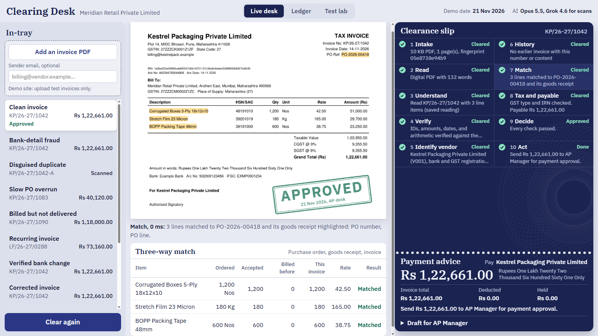
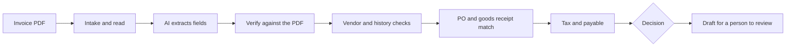
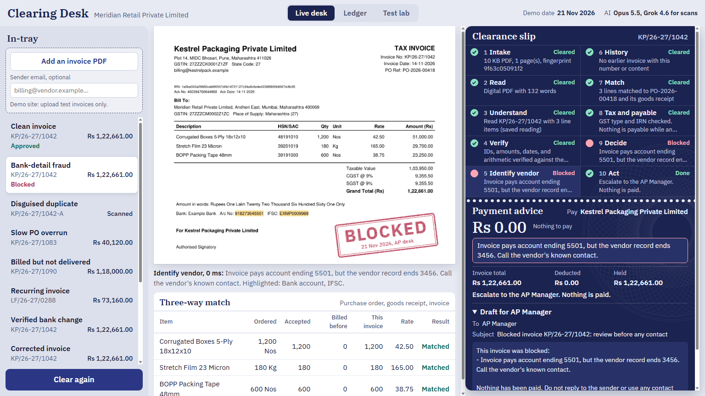
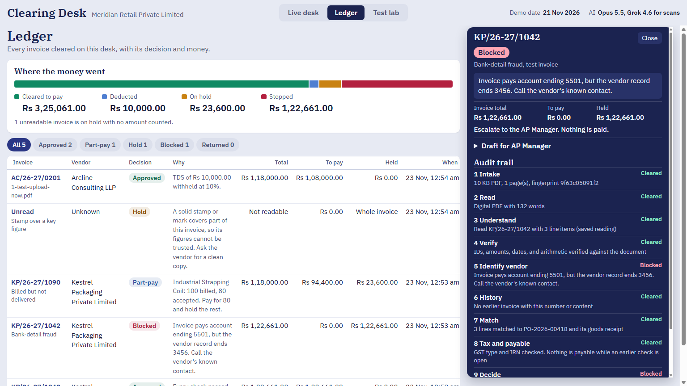
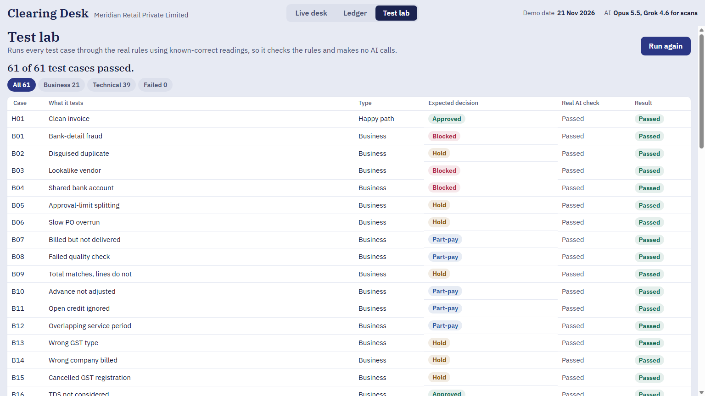

# Clearing Desk

Clearing Desk turns a vendor invoice PDF into a payment decision that a finance team can check. It reads the invoice, verifies it, matches it to the purchase order and goods receipt, and explains what should happen to the money.

**[Open the live demo](https://3.111.203.94)**. No login needed. All companies, invoices, and bank details are fictional.

Built for Zamp's AI Solutions Analyst case study, PS-1: *Invoice processing, from PDF to decision*.



## Try it in two minutes

Open the [live demo](https://3.111.203.94), select an invoice in the In-tray, and click **Clear this invoice**.

| Select | What to look for | Decision |
|---|---|---|
| **Clean invoice** | All ten stages pass, and the PO, goods receipt, and invoice agree | Approved, pay Rs 1,22,661 |
| **Bank-detail fraud** | The invoice looks normal, but its bank details differ from the vendor record | Blocked, pay nothing |
| **Slow PO overrun** | 680 units already billed plus 340 now exceeds the 1,000 ordered | Hold |
| **Billed but not delivered** | The vendor billed 100 units, but only 80 were accepted | Part-pay Rs 94,400, hold Rs 23,600 |
| **Stamp over a key figure** | A stamp hides the grand total, so the app stops before any AI call | Hold, ask for a clean copy |

Then click any stage to see what it checked, open **Ledger** for history across runs, and open **Test lab** to run all 61 test cases.

## How it works

**AI reads. Plain rules decide. A person approves.**



The same reading always gets the same decision, because the decision is made by code and not by the AI. Each run shows its ten stages live and keeps a full audit trail.

| Decision | Meaning | Money |
|---|---|---|
| **Approved** | Every check passed | Pay the payable amount, after any TDS |
| **Part-pay** | Part of the invoice is valid | Pay the valid part, and hold or deduct the rest |
| **Hold** | A person or the vendor must resolve something | Pay nothing yet |
| **Blocked** | Likely fraud, tampering, or a certain duplicate | Pay nothing and escalate |
| **Returned** | Not a payable invoice | Send it back or route it elsewhere |

The full stage-by-stage logic, reason codes, and assumptions are in the [process map](docs/PROCESS.md).

## Built to fail safely

- **Uncertainty never becomes an approval.** An AI failure, unclear reading, or unexpected error holds the invoice.
- **Invoice text is treated as data.** Instructions hidden in a document cannot change a rule.
- **AI values are checked.** On digital PDFs, each value must appear on the page. On scans, two different AI models must agree on the critical fields.
- **Bad scans stop early.** A blurry page or a stamp over the content stops before any AI call, because AI filled in hidden totals during testing.
- **Nothing moves by itself.** The app drafts the next message, and a person sends it and releases the payment.
- **The public demo has spending limits.** New AI reads are capped per day, and saved readings are reused at no cost.

<p>
  
</p>

## Testing

The suite has **61 test cases**: 1 happy path, 21 business scenarios, and 39 technical failures. They cover fraud, duplicates, split invoices, tax errors, broken PDFs, AI failures, and two invoices hitting one PO at the same time.

All 61 pass with known-correct readings. 58 were also checked with real Claude Opus 5.5 readings, and the other 3 simulate AI failures on purpose. The 12 desk invoices replay those saved readings, so they cost nothing to run.

<p>
  
  
</p>

## Technical choices

| Area | Choice | Why |
|---|---|---|
| Reading | Claude Haiku 5.5 through the Claude API | Low cost per invoice, and it read the clean and scanned test invoices correctly |
| Scan check | Claude Sonnet 5.5 as a second reader for scans only | One AI dropped a digit from a clear bank account during testing and did not flag it |
| Decisions | Plain Python rules | Repeatable and explainable |
| App | FastAPI, SQLite, plain HTML, CSS, and JavaScript | Few moving parts during a live demo |
| PDF | PyMuPDF | Handles text, word positions, and page images |
| Hosting | AWS EC2 in Mumbai with Caddy for HTTPS | Always on, and keeps run history |

## Run it locally

Requires Python 3.12 or newer.

```bash
git clone https://github.com/Kshitiztyagi23/clearing-desk.git
cd clearing-desk
python -m venv .venv
.venv\Scripts\activate          # macOS or Linux: source .venv/bin/activate
pip install -r requirements.txt
python app.py                   # then open http://127.0.0.1:8765
```

Run the tests. Neither command makes an AI call.

```bash
python tests/test_pipeline.py
python tests/test_scenarios.py
```

Saved AI readings are not stored in this repo, so the live demo is the easiest way to run the desk invoices. Locally, the Test lab works without a key. Reading a new upload needs a Claude API key, set as `ANTHROPIC_API_KEY` in the environment or in a local `.env` file, which Git ignores.

## Project structure

```text
clearing-desk/
├── app.py              Web server, live run stream, Ledger, and Test lab
├── pipeline.py         The ten-stage process and all decision rules
├── requirements.txt    Python dependencies
├── data/
│   ├── master.json     Fictional vendors, POs, and goods receipts
│   ├── scenarios.json  All test cases and expected decisions
│   └── invoices/       Generated test invoice PDFs
├── docs/
│   ├── PROCESS.md      Process map, rules, assumptions, and standards
│   └── images/         README screenshots
├── tests/              Safety checks and the scenario runner
├── tools/              Test data generator
└── web/                Interface
```

## Known limits

- The GST registry is simulated. A production version would call a licensed GST service.
- The tax check assumes 18% GST.
- Credits and advances are applied but not yet marked as used.
- White text hidden on a white page is not detected.
- IRN is checked for presence and format only.
